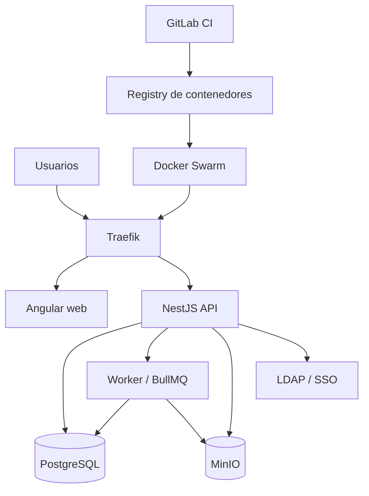
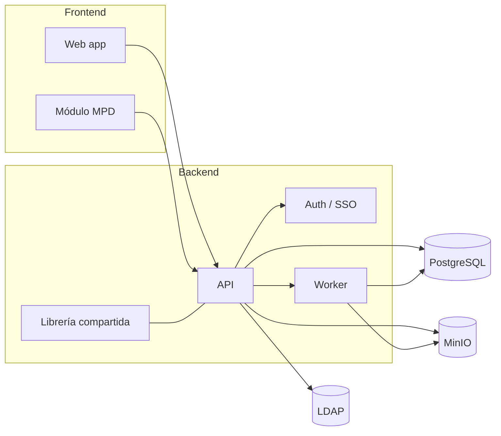

# Sudocu — Vista de Arquitectura

[English](README.md) | [Español](README.es.md)

> Arquitectura de alto nivel de **Sudocu**, la plataforma de gestión documental del SIU implementada en **UNGS**.
> El código, la infraestructura y los datos son privados. Este repositorio contiene solo diagramas de arquitectura.

**Mi alcance:** funcionalidades del MPD, compartición de documentos con OTP, filtros avanzados, despliegue con Docker Swarm y desarrollo spec-driven con OpenSpec.

## Despliegue

## Componentes

## Notas

- No se publica código, capturas ni datos institucionales.
- Repositorio pensado como vista de alto nivel para portfolio y entrevistas.
