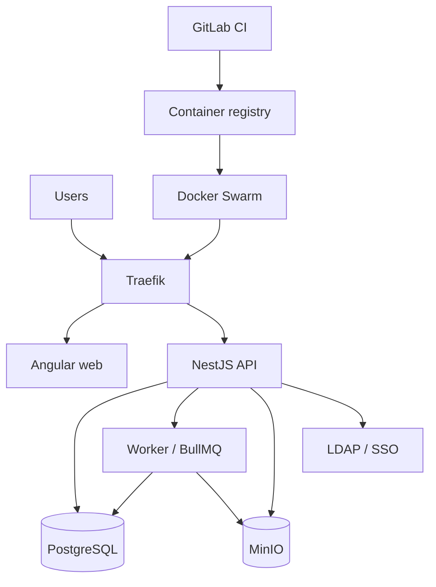
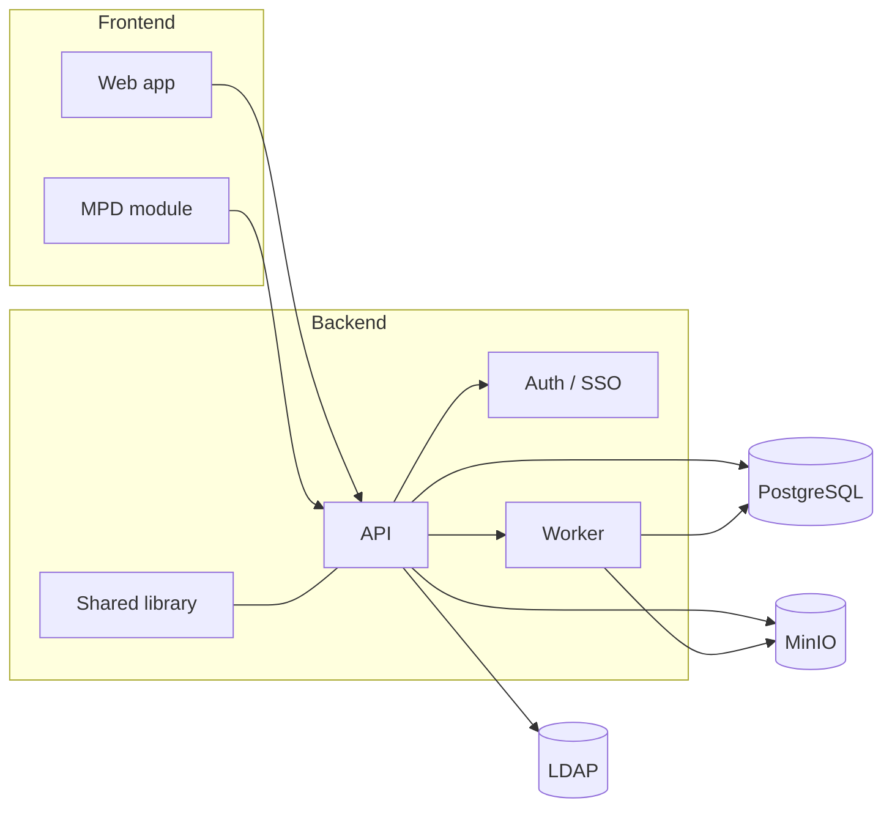

# Sudocu — Architecture Overview

[English](README.md) | [Español](README.es.md)

> High-level architecture of **Sudocu**, the SIU document management platform implemented at **UNGS**.
> Product code, infrastructure details and data are private. This repository contains architecture diagrams only.

**My scope:** MPD features, OTP document sharing, advanced filters, Docker Swarm deployment and spec-driven development with OpenSpec.

## Deployment

## Components

## Notes

- No source code, screenshots or institutional data are published.
- Repository intended as a high-level overview for portfolio and interviews.
