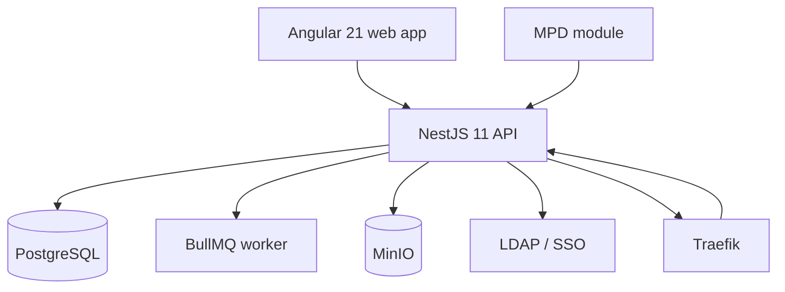

# Sudocu — Document Management Platform

> Case study of my work as a **Full Stack Developer at UNGS** on the Sudocu project.
> The product code and institutional data are private. This repository documents the architecture, my responsibilities and the engineering practices used.

## What is Sudocu?

Sudocu is the **Sistema Único Documental del SIU**, implemented at the **Universidad Nacional de General Sarmiento (UNGS)**. It is a distributed platform for creating, managing, signing and distributing official documents, records and procedures across universities and public organizations.

## My role

**Full Stack Developer** · Jan 2025 – present · Buenos Aires, Argentina

I work end-to-end across the Angular frontend and the NestJS backend, with a focus on the **MPD** module and the platform's operational side.

### Product work

- End-to-end features for the **MPD** module: authorization queues, restricted-document visibility and record editing.
- Document sharing with **OTP codes** and user groups for controlled external access.
- Refactor and unification of MPD views, services and endpoints.
- Advanced search and filters by category, usage, date and keyword.
- Import validations and 500-error fixes for bulk file uploads.
- Automated tests with **Jest** and documentation in **Docusaurus**.

### Platform work

- Deployment and operation of servers with **Docker Swarm**, **Traefik**, TLS, **MinIO** and **LDAP**.
- Overlay networks and production stacks.
- CI/CD pipelines with Docker and GitLab CI.
- Adoption of **spec-driven development (OpenSpec)** to define specifications, acceptance criteria and validation before implementation.

## Architecture

The repository is a monorepo with multiple applications:

| App | Responsibility |
|---|---|
| `web` | Main Angular application |
| `mpd` | Document publication and management module |
| `api` / `api2` | API v1 (legacy) and API v2 (NestJS) |
| `worker` | Background jobs with BullMQ |
| `mpc` | Configuration module (legacy) |
| `shared` | Shared entities, services and utilities |

## Stack

`Angular 21` · `Angular Material` · `NgRx` · `NestJS 11` · `TypeScript` · `PostgreSQL` · `TypeORM` · `BullMQ` · `Docker` · `Docker Swarm` · `Traefik` · `MinIO` · `LDAP` · `Jest` · `Docusaurus` · `OpenSpec`

## Engineering notes

- **Spec-driven development:** changes start with a written spec and acceptance criteria, then move to implementation and validation.
- **Container-first workflow:** development, builds and tests run inside the Docker stack.
- **Operational ownership:** deployments are treated as part of the feature, not as an afterthought.
- **Documentation as a deliverable:** changelog, FAQs and deployment guides live with the product.

## Links

- [LinkedIn](https://www.linkedin.com/in/luca-domio-dev)
- [Portfolio](https://github.com/lDomio)
- Code and product details are private; available to discuss in interviews.
